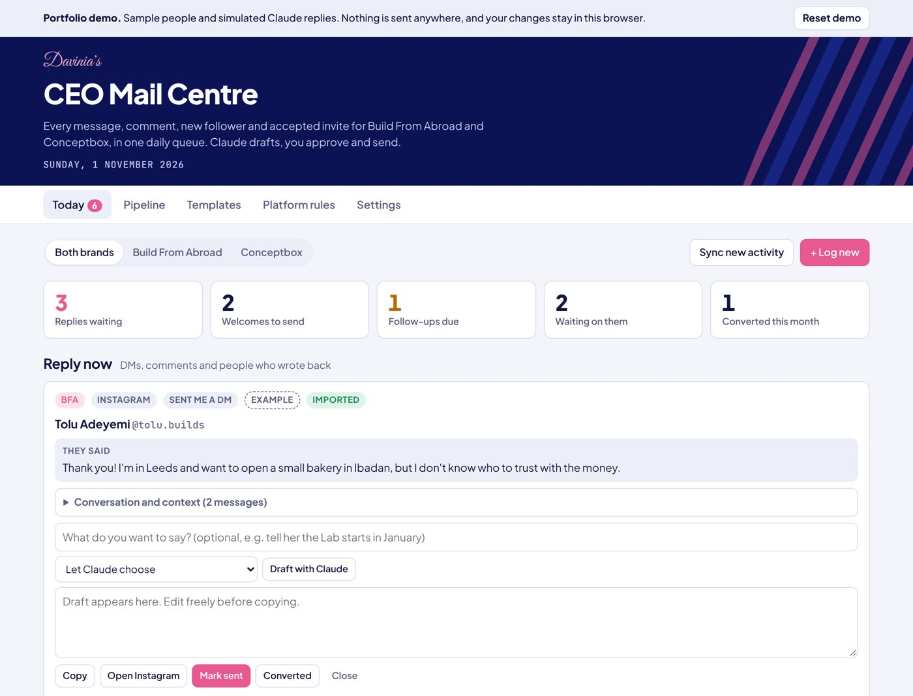
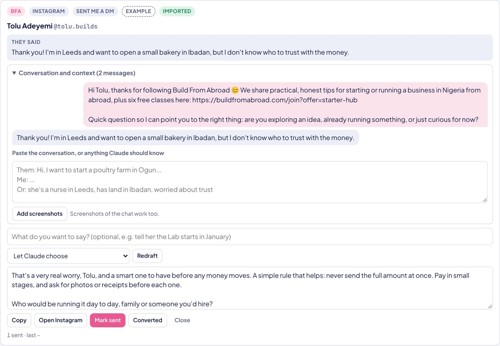
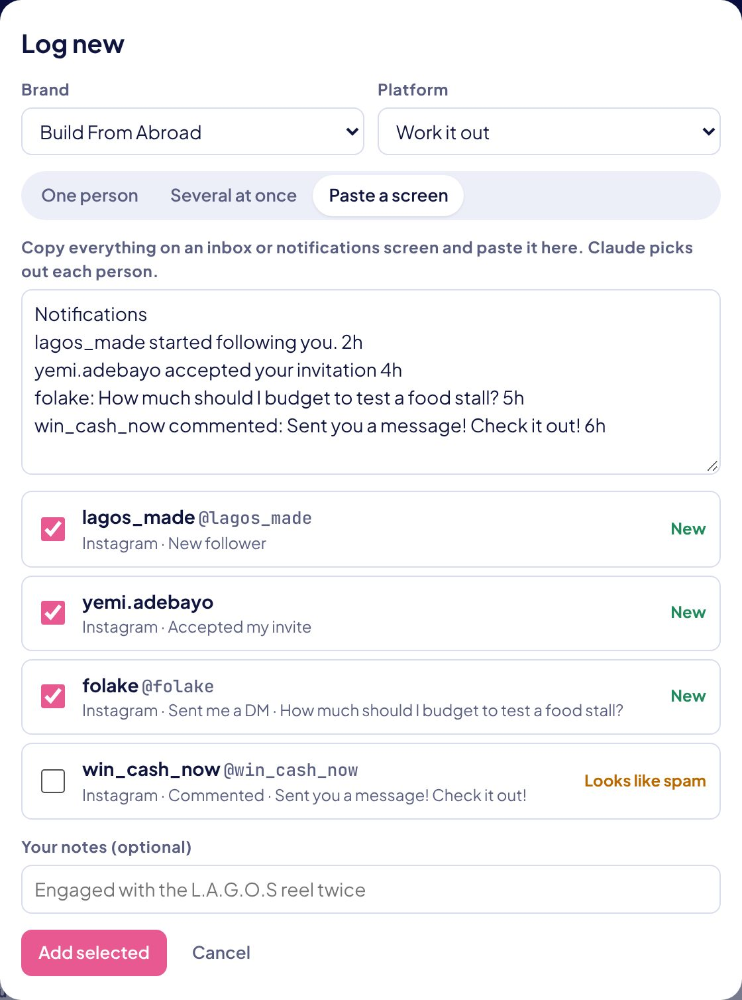
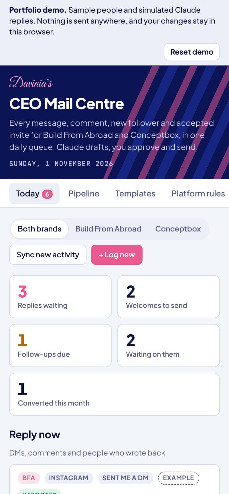
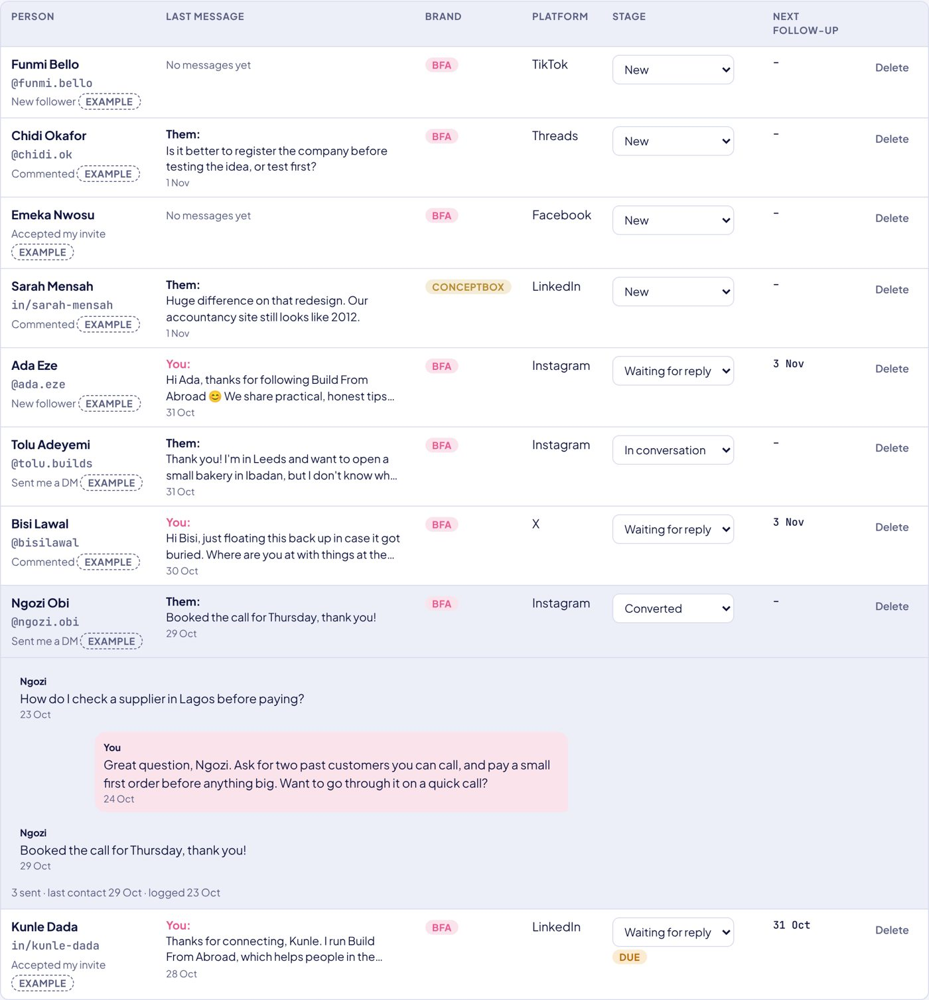
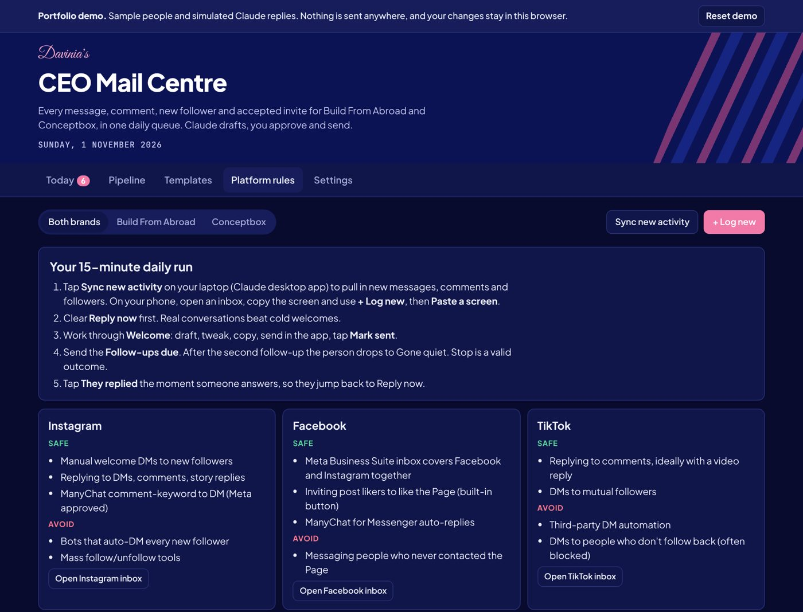

# CEO Mail Centre

**A daily social-response workspace, with reply drafting and structured follow-ups. The public demo uses simulated replies and fictional people.**

Created through AI-assisted development, directed by Davinia Edafioka for her businesses, Build From Abroad and Conceptbox Consulting. Designed to support a founder and virtual assistant.

**Live demo:** _add your Netlify or GitHub Pages link here_



---

## The problem

Running two small brands across seven platforms (Instagram, Facebook, TikTok, YouTube, LinkedIn, X and Threads) meant:

- New followers and accepted invites went unwelcomed, because each platform hides them in a different place.
- Follow-ups depended on memory. Some people were chased too much, others never heard back.
- Replies written in a hurry sounded templated, and ignored what the person had actually said.
- Automation tools that send DMs automatically break platform rules and put accounts at risk.

## The solution

A single triage desk that gathers everything into one daily queue, helps write a reply that fits the conversation, and keeps a person in charge of every message sent.

| | |
| --- | --- |
| **One queue, four lanes** | Reply now, Welcome (new followers and accepted invites), Follow-ups due, and Sent, waiting for reply. |
| **Context-aware drafting** | Claude reads the whole conversation, pasted chat or screenshots, plus a one-line instruction such as "give one tip about trust", then writes in the owner's voice. It answers the actual question and never repeats a link already sent. |
| **Templates in one tap** | House welcome messages and follow-ups, with the person's first name filled in. |
| **Paste a screen** | Copy any inbox or notifications page and the app picks out each person, flags duplicates and filters likely spam. |
| **Follow-ups with a limit** | Day 3, then day 7, then the person moves to Gone quiet. Not replying is treated as a valid answer. |
| **Pipeline** | Everyone in one searchable table, showing who spoke last and the next follow-up date. Tap a row to read the whole chat. |
| **Safe by design** | Nothing is sent automatically. A person copies the message, sends it in the platform's own app, then presses Mark sent. |
| **Team-ready** | Built so a virtual assistant can work the queue, with platform rules and a 20-minute daily routine. |



<table>
<tr>
<td width="55%"></td>
<td></td>
</tr>
</table>





## How it was built

- **One self-contained HTML file.** HTML, CSS and plain JavaScript, with no framework and no build step.
- **Built and run as a Claude artifact.** Inside claude.ai the app uses Claude's runtime for a shared database (so the owner and an assistant see the same records), Claude for drafting and reading screens, and Claude's browser pane to sync activity from signed-in inboxes.
- **Portable.** A small shim (`public/claude-shim.js`) lets the same file run anywhere else: as a static demo, or locally with your own Anthropic API key through a zero-dependency Node server.
- **Light and dark themes**, a phone-first layout and keyboard-friendly controls.
- **Brand system:** Midnight Blue, Royal Blue and Carnation Pink, Plus Jakarta Sans, and a chevron stripe motif.

## Try it

### Option 1: the demo (no setup)

Open the live demo link above. It loads nine fictional people and simulates Claude's replies, so it works without an API key and sends nothing anywhere. Your changes stay in your browser, and **Reset demo** puts the sample data back.

To run the demo on your own computer:

```bash
npm run demo
# then open http://localhost:3000/?demo=1
```

### Option 2: run it with real Claude drafting

You need [Node.js](https://nodejs.org) 18 or newer. There are no npm packages to install.

```bash
cp .env.example .env     # then add your Anthropic API key
npm start                # open http://localhost:3000
```

Without a key the app still works fully, apart from Draft with Claude and Paste a screen.

The Claude-hosted capabilities below describe the supplied implementation and intended runtime. They have not been independently verified as part of this portfolio package review.

## What runs where

| Feature | Inside claude.ai | Local with API key | Public demo |
| --- | --- | --- | --- |
| Queues, templates, follow-ups, pipeline, platform rules | Yes | Yes | Yes |
| Draft with Claude, including screenshots | Yes (Claude in the viewer) | Yes (Anthropic API) | Simulated |
| Paste a screen | Yes | Yes | Simulated (simple text matching) |
| Saving records | Shared claude.ai database, across devices and users | This browser only | This browser only |
| Sync new activity from signed-in inboxes | Yes, in the Claude desktop app | No | No |

**Why Sync only works inside Claude:** it reads each platform's inbox in Claude's built-in browser, where the owner is already signed in. The platforms do not offer open APIs for reading DMs and new followers. Doing this outside Claude would need each platform's official API, such as a Meta developer app with messaging permissions and app review.

## Deploy the demo

The demo is a static site in `public/`. No build step and no environment variables are needed.

- **Netlify:** connect the repo. `netlify.toml` already publishes `public/`.
- **GitHub Pages:** in the repo, go to Settings > Pages and set the source to **GitHub Actions**. `.github/workflows/pages.yml` deploys on every push to `main`.

On any host other than localhost the app starts in demo mode automatically. Add `?demo=0` to the address to turn demo mode off.

## Project structure

```
ceo-mail-centre/
├── public/
│   ├── index.html          The whole app
│   └── claude-shim.js      Stands in for Claude's runtime: demo mode, or local API mode
├── docs/screenshots/       Images used in this README (demo data only)
├── scripts/check-app.js    Syntax check for the app's inline script
├── server.js               Optional local server: forwards drafting to the Anthropic API
├── netlify.toml            Netlify deploy settings
├── .github/workflows/      GitHub Pages deploy
├── .env.example            Placeholders only
└── package.json            npm start, npm run demo, npm run check
```

## Configuration

`.env` (copy from `.env.example`). Only needed for Option 2.

| Variable | Purpose |
| --- | --- |
| `ANTHROPIC_API_KEY` | Turns on real drafting and Paste a screen. |
| `ANTHROPIC_MODEL` | Default `claude-sonnet-5-5`. |
| `ANTHROPIC_MODEL_COMPLEX`, `ANTHROPIC_MODEL_QUICK` | Optional per-tier models. |
| `ANTHROPIC_MAX_TOKENS` | Default 2000. |
| `PORT`, `HOST` | Default `3000` and `127.0.0.1`. |

Brand details are near the top of the script in `public/index.html`: `BRAND_BRIEF` (what each brand offers, used in prompts), `GOALS`, `DEFAULT_SETTINGS` (public page links), and the templates in `BFA_WELCOME` and `buildTemplates()`.

## Privacy and security

- **No real customer data.** Every person in the demo and the screenshots is fictional. Real contacts and conversations live in the owner's private claude.ai database and are not part of this repository.
- **No secrets.** `.env` is ignored by git. Only `.env.example`, with placeholders, is committed.
- **Demo replies and extraction are simulated in the browser.** Contact records and drafting inputs are not submitted to an AI API in default public demo mode. The page requests fonts from Google Fonts, and clicking public brand or platform links opens those services.
- **The optional local server has no login.** Keep `HOST=127.0.0.1` and do not deploy `server.js` publicly, or anyone who reaches it could use your API key. Deploy only the static demo.

## Licence

© 2026 Davinia Edafioka. All rights reserved. Shared for portfolio purposes.
